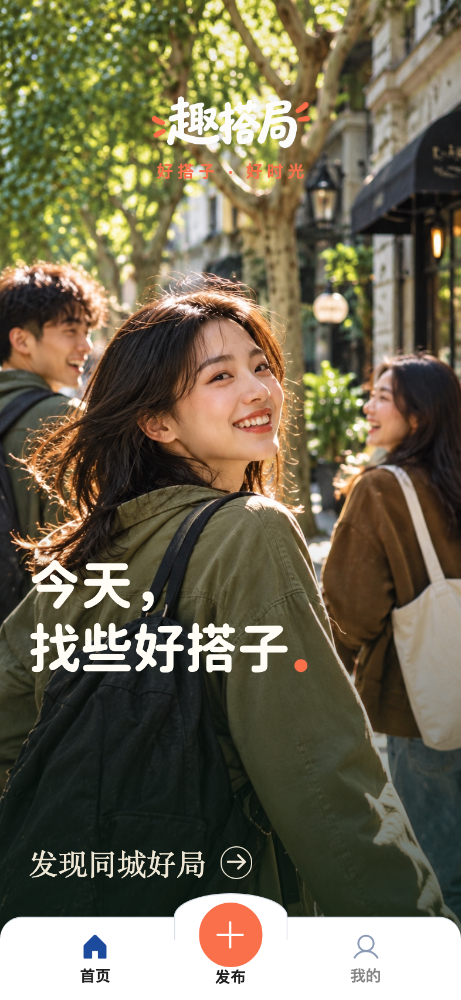
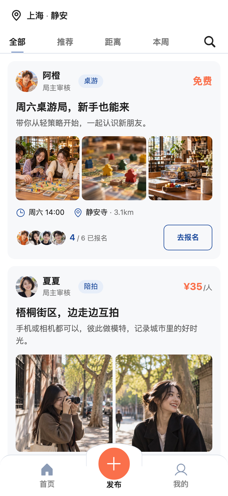
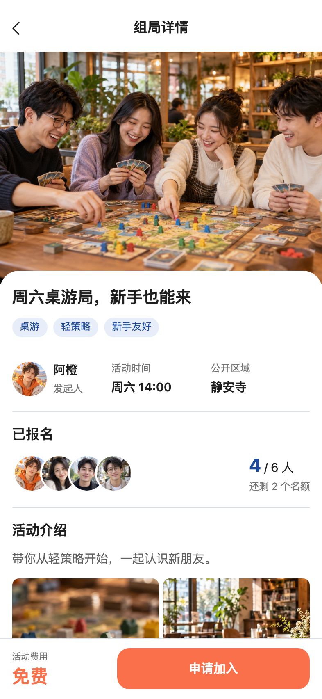
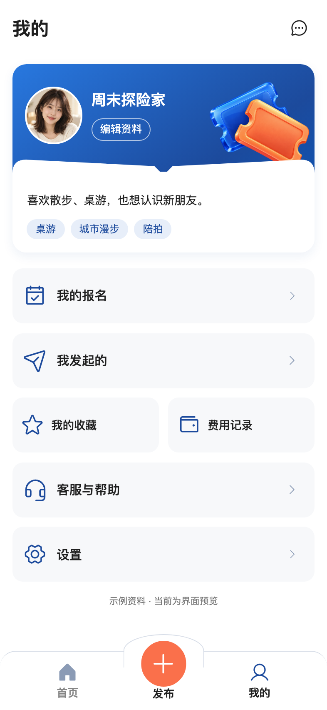
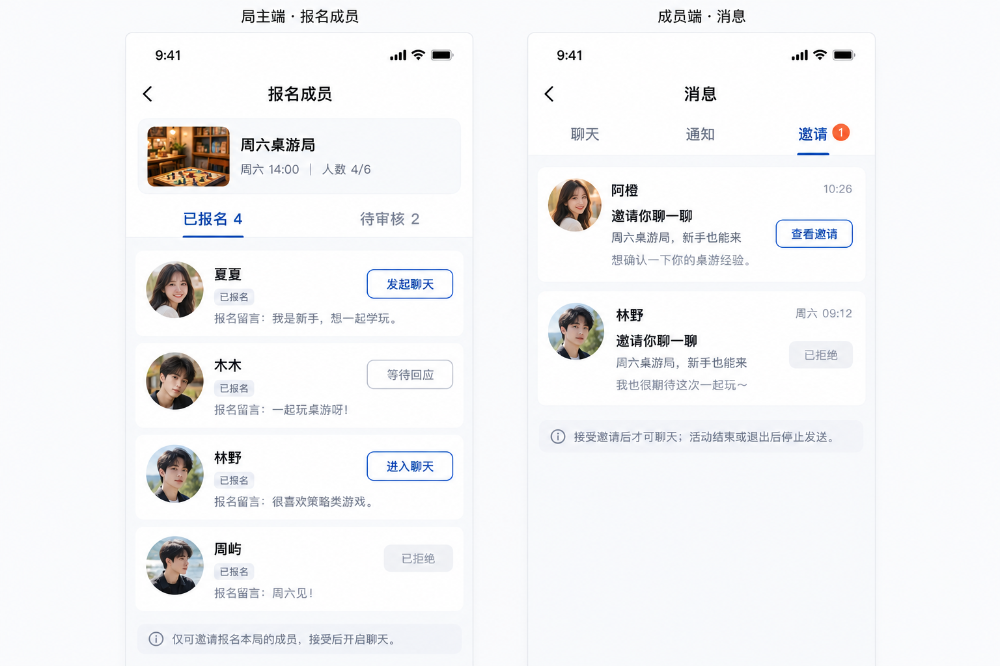
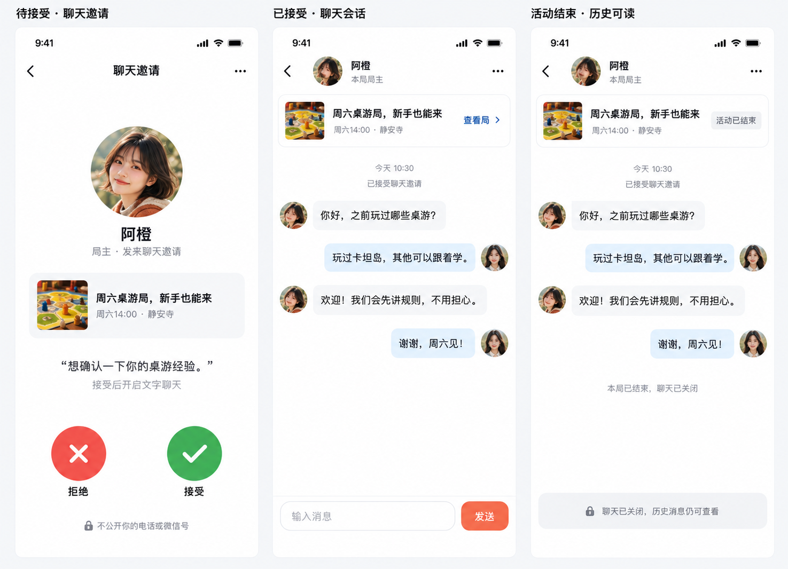
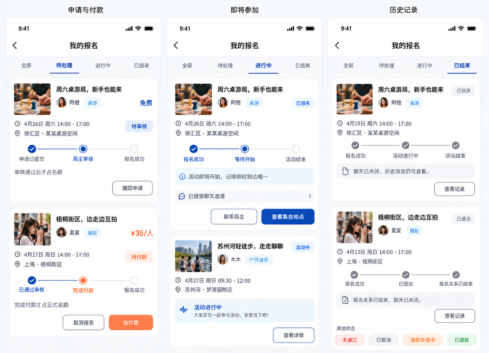

# 趣搭局， 好搭子 · 好时光

**同城兴趣组局小程序｜找局、发局、认识同频的人。**

从一场桌游、一段城市漫步，到一次互拍和户外活动，让兴趣成为见面的理由。趣搭局围绕「发现 → 报名 → 参与」设计，保留精简的 **首页 / 发布 / 我的** 三个导航入口，把找局、筛选和报名集中在一条清晰的路径中。

## 界面预览

从第一眼的品牌氛围，到找局、报名和个人管理，让用户快速理解活动，也让你的品牌被记住。

<table>
  <tr>
    <th align="center">首页</th>
    <th align="center">发现 · 同城好局</th>
  </tr>
  <tr>
    <td align="center"></td>
    <td align="center"></td>
  </tr>
  <tr>
    <th align="center">详情 · 看清再报名</th>
    <th align="center">我的 · 兴趣身份卡</th>
  </tr>
  <tr>
    <td align="center"></td>
    <td align="center"></td>
  </tr>
</table>

界面采用蓝白基调、橙色重点操作和浅色卡片。首页突出摄影氛围，列表用图文记录表达活动，详情强调发起人、时间地点、参与者和报名条件。

## 报名与沟通体验
### 局主发起聊天 · 成员消息入口

局主在本局报名成员中发起聊天邀请，可区分等待回应、已接受和已拒绝。成员通过消息中的邀请入口查看，不接受邀请就不会开启聊天。

### 聊天邀请 · 会话与关闭状态

邀请页采用通话式操作布局，底部红叉拒绝、绿勾接受，但邀请的是**文字聊天，不是语音通话**。接受后进入本局对应的一对一会话；活动结束或报名关系失效后关闭发送，历史消息仍可查看。

### 我的报名 · 每个局的进度

以「待处理 / 进行中 / 已结束」组织报名记录，展示待审核、待付款、已报名待开始、活动中、已结束和已退出等状态。收费局明确提示付款完成才占正式名额，按状态提供相应操作入口。

## 产品功能

以少而精的功能串起完整组局体验，适用于同城兴趣活动、桌游社群、城市漫步、摄影互拍与户外搭子等场景。

| 模块 | 功能设计 | 产品价值 |
| --- | --- | --- |
| 发现同城好局 | 地区选择、关键词搜索、类型/费用/距离/时间/报名方式筛选 | 缩短找局路径，让用户找到适合自己的活动 |
| 附近兴趣推荐 | 围绕距离、兴趣标签、活动时间和剩余名额设计推荐规则 | 让活动发现更贴近用户的兴趣与安排 |
| 活动图文卡片 | 发起人头像昵称、1–3张预览图片、时间地点、费用、横向堆叠报名头像 | 一眼了解活动氛围、参与情况和费用 |
| 活动详情 | 活动介绍、标签、发起人、报名人数、公开区域、补充照片、报名步骤 | 报名前看清活动，减少反复沟通 |
| 发布组局 | 朋友圈式文本+图片；桌游、陪拍、向导、户外、交友五类；兴趣标签与草稿 | 降低发布门槛，用内容表达活动特色 |
| 活动设置 | 时间、报名截止、人数、公共区域、集合细节、审核方式、免费或收费 | 兼顾轻量组局与有组织的活动运营 |
| 报名与审核 | 报名留言、个人信息卡片、局主审核或直接加入、名额控制、退出 | 让局主了解成员，让报名过程更清楚 |
| 活动基金 | 审核后付款、付款成功占名额、费用记录、退款与结算流程设计 | 明确费用用途，串起收费活动的资金流程 |
| 邀请式聊天 | 局主邀请、成员接受或拒绝、本局一对一聊天、关系结束后关闭发送 | 保留必要沟通，避免开放式陌生私信打扰 |
| 我的报名与个人中心 | 简介与兴趣、报名进度、我发起的、收藏、费用记录、消息、客服与设置 | 集中管理参与记录与个人活动安排 |
| 运营管理 | 用户与内容审核、活动与报名管理、标签维护、退款投诉、财务结算模块设计 | 围绕活动运营组织管理流程 |

## 核心机制

- **默认局主审核，可切换直接加入。** 报名时可留一句话，帮助局主了解参与者。
- **免费局与收费局并存。** 收费用于活动基金，说明用途及包含内容；收费审核局在审核通过后付款，付款完成才占正式名额。
- **分层展示地点。** 报名前展示区域或公共场所，审核通过/直接加入成功后按产品规则展示集合细节；收费局付款成功后才占正式名额。
- **聊天有边界。** 只有局主可邀请报名自己活动的用户聊天，对方接受后开启；报名关系失效或活动结束后停止发送，保留历史可读。
- **公开资料保持克制。** 个人信息卡片突出兴趣与简介，地点分层展示，聊天需双方同意。

## 技术与定制方向

**uni-app + Vue 3 + TypeScript + Vite**，以微信小程序为主要场景，保留支付宝、小红书平台适配目录，为品牌与业务扩展提供清晰的工程结构。

- 配色、字体、字阶、字重、行高与通用圆角统一管理，便于品牌换肤。
- 图文网格、报名头像堆叠、安全区头部和底部导航采用共享组件。
- H5 预览便于视觉评审和品牌方案沟通。
- 品牌视觉、活动分类、兴趣标签、报名规则、业务接口、管理端及多平台适配可作为定制方向。

## 适用场景

- **同城兴趣平台**：围绕桌游、陪拍、向导、户外、交友组织活动发现与报名体验。
- **桌游店与活动空间**：展示活动内容、招募成员，突出线下活动氛围。
- **城市漫步与摄影社群**：用图文介绍路线与主题，让同频的人更容易相遇。
- **户外与本地社群**：集中呈现活动安排、参与进度和成员沟通。

## 合作方向

- **源码与交付方案**：围绕你的目标平台和业务范围沟通项目源码及交付内容。
- **品牌定制**：名称、字标、配色、首页视觉与活动分类，塑造自己的产品形象。
- **业务定制**：报名审核、收费规则、成员沟通和运营流程，按具体场景设计。
- **平台拓展**：结合渠道需求沟通小程序适配、H5 展示与运营管理端。

这不仅是一个找搭子的入口，也是一套围绕同城活动发现、报名与沟通的产品设计。让你的社群、门店或本地业务拥有更清晰的线上呈现。

## 联系作者 · 获取完整代码 / 产品定制

想获取完整项目源码、了解交付方案，或定制自己的同城活动小程序？欢迎联系，咨询产品合作或定制开发。

**公司门户：[gleamseek.com](https://gleamseek.com)**

**邮箱：[chrisleo.yu.cn@gmail.com](mailto:chrisleo.yu.cn@gmail.com)**

也可扫描下方二维码联系：

沟通时建议附上使用场景、目标平台、希望交付的功能范围与时间安排，便于确定合适的方案。
